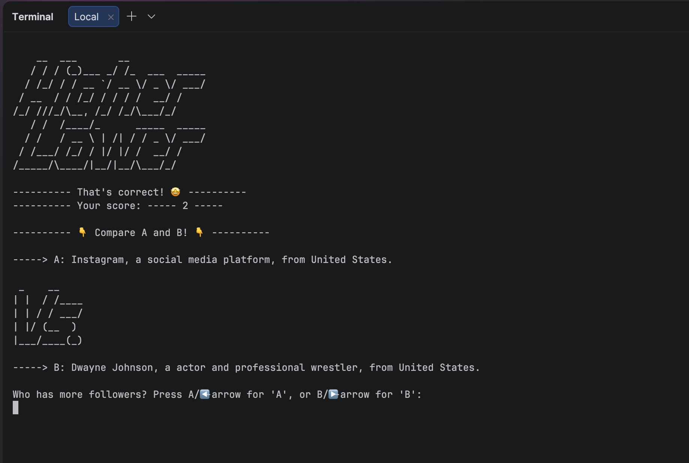

# Higher Lower README 

### This is my solution to the Day 14 exercise in Angela Yu's "100 Days of Code"-course on Udemy.     

> [!IMPORTANT]
>
>This program uses the `readchar`-package for reading user inputs.        
>In a virtual environment, install the package by running:     
>      
>`python -m pip install -r requirements.txt` 

## Description

A game where the user is presented with two random Instagram profiles, A and B, and has to guess which of the two profiles is the most popular. If the user is wrong, the round ends, and if the user is correct, old B becomes new A, and B gets a new random profile. And the user has to guess again. This goes on until they either lose (guesses incorrectly) or manages to get 25 correct guesses, which ends the game. The user is then asked if they want another go or to quit the game.

This game is inspired by the [internet game Higher Lower](https://www.higherlowergame.com/).

## To do list

- [x] Print welcome screen and ask user to begin a new game or to quit
- [x] Provide user two random alternatives, profile A and profile B from game_data.py and provide user a way to guess which profile is the most popular.
- [x] Determine whether user guesses correctly or incorrectly
- [x] If correct guess, find a way to swap out alternative A with B, and generate a new random profile for B
- [x] Find a way to keep track of user's score.
- [x] Find a way to end a round when either of two conditions are met: User guesses incorrectly OR manages to guess correctly 25 times (gets a score of 25). When a round ends, the user are asked if they want a new round or to quit the game.

### Screenshot of finished solution

 